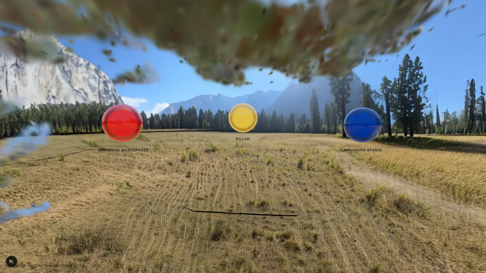
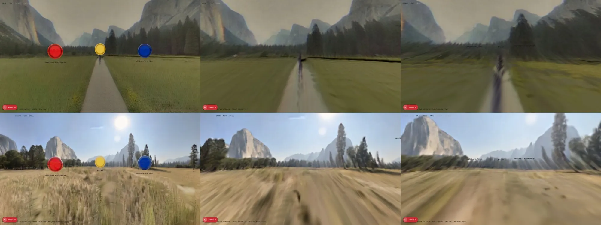
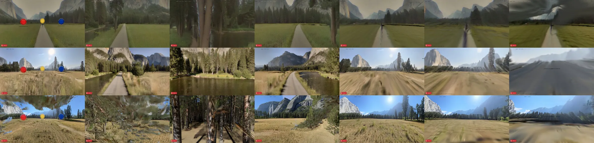

# Render log

Every World Labs and Nano Banana generation, newest last. Brief: `docs/briefs/rendering.md`.
Big files live in `~/build/wildlabs-assets/` (inputs, worlds, stills), never in git.

## Yosemite (session 1, Oct 21 2026)

### Input decision: single image, not multi-image or a 2:1 panorama

Source: `IMG_9486.HEIC`, 9934×3790 (about 2.6:1), roughly 170–180° wide and 65° tall. Not a 360.

| Option | World Labs credits | Verdict |
|---|---|---|
| **Single image** (`is_pano: false`); Marble generates the rest of the sphere | 80 pano + 1,500 world = **1,580** | **Chosen** |
| Multi-image (panorama plus IMG_3023/3024/3029 with directions) | 100 + 1,500 = 1,600 | All three extra photos face the same ridge (Cathedral Rocks and Spires) as the panorama's right half, under heavier haze. Direction mode wants non-overlapping views, and each photo has people to remove. Kept as the second attempt if the Spires side is weak. |
| Extend to a 2:1 panorama with Nano Banana, then `is_pano: true` | 0 + 1,500 = 1,500, plus 3–4 images | Saves 80 credits (6¢), but Nano Banana would invent about 80% of the sphere without understanding the 360° (equirectangular) format, so the sky overhead, the ground underfoot and the wraparound seam would all suffer. World Labs also notes phone panoramas often fail its pano check for lack of top-to-bottom coverage. |

Problems found in the source beyond the people: a lens starburst around the sun, a black stitching wedge
and seam along the top right, a thin black sliver on the left edge, cars, vans and RVs (plus an orange construction
barrier) along the road at the tree line, and a crisper, bluer sky than the hazy IMG_3029. Eric's calls (Oct 21):
soften the sun, add haze, remove the cars.

### Input pipeline (`scripts/render/yosemite_input.py`)

1. HEIC → JPEG with `sips` into `~/build/wildlabs-assets/inputs/yosemite/`. IMG_3023/3024/3029 carry EXIF
   rotation (orientation 6); apply it before sampling or sending them anywhere.
2. Cut three tiles from the full-resolution panorama and clean each with Nano Banana 2:
   `people_cars` (4:3, 4K), `road_right` (21:9, 2K), `sun` (1:1, 2K).
3. Paste each cleaned tile back through a feathered mask that covers only the edit, so El Capitan and the rest of
   the frame keep their original pixels.
4. Trim the top 260 px (wedge and seam) and the left 8 px.
5. Haze: blend toward IMG_3029's pale sky colour `(160, 188, 225)`. The blend is 30% at the top of the frame, 24%
   over the walls, 16% at the tree line and 3% in the foreground, with saturation at 90%.

### Generations

| Date | Tool · model | Input | Prompt | Cost | Time | Output | Verdict |
|---|---|---|---|---|---|---|---|
| Oct 21 | AI Gateway · `google/gemini-3.1-flash-image` | `tiles/people_cars.png` | Remove people, bottle, frisbee, marker post, cars, RVs; fill with meadow and tree line | None (failed) | — | — | **Blocked:** Gateway returned 403 `customer_verification_required` ("requires a valid credit card on file … to unlock your free credits"). Needs a card on the Vercel team. |
| Oct 21 | AI Gateway · `google/gemini-3.1-flash-image` | `tiles/people_cars.png` | Same | None (failed) | — | — | Card added; free credit active. **Blocked:** 403 `RestrictedModelsError`, "Free tier users do not have access to this model." |
| Oct 21 | AI Gateway · `google/gemini-2.5-flash-image` | `tiles/sun.png` | Soften starburst into a diffuse hazy sun | None (failed) | — | — | Same 403: not on the free tier. |
| Oct 21 | AI Gateway · `google/gemini-3.1-flash-lite-image` | `tiles/sun.png` | Same | None (failed) | — | — | Same 403: no Nano Banana model is on the free tier. |
| Oct 21 | — | — | — | — | — | — | Eric bought $55 of paid Gateway credit, which ends the free tier. That reverses the Oct 20 "stay on free tier" decision for this project and needs updating in `PLAN.md` after merge. |
| Oct 21 | Gateway · Nano Banana 2, 4K, 4:3 | `tiles/people_cars.png` (2880×2150) | Remove people, bottle, frisbee, marker post, cars, vans, RVs; fill with meadow and tree line; keep everything else | $0.151 | 47 s | `inputs/yosemite/tiles/people_cars.clean.png` (4800×3584) | Clean removal and a convincing rebuilt tree line. Came back warmer and brighter than the source, so `compose` colour-matches each tile before pasting. |
| Oct 21 | Gateway · Nano Banana 2, 2K, 21:9 | `tiles/road_right.png` (1600×686) | Remove parked cars, orange barrier, equipment along the road | $0.101 | 21 s | `tiles/road_right.clean.png` | Clean. One small pale speck (probably a boulder) remains in the far tree line. |
| Oct 21 | Gateway · Nano Banana 2, 2K, 1:1 | `tiles/sun.png` (1600×1600) | Replace the starburst with a diffuse sun through haze | $0.101 | 17 s | `tiles/sun.clean.png` | Starburst gone; the sun reads as a soft, slightly grey disc. Good enough, since Marble repaints the sky. |
| Oct 21 | Gateway · Nano Banana 2, 2K, 21:9 | preview, prompt "x" | Diagnostic call (zsh didn't word-split a `$NB` command variable, so the first still batch never ran) | $0.101 | 21 s | discarded | Wasted image. Write commands out in full in zsh. |
| Oct 21 | Gateway · Nano Banana 2, 2K, 21:9 | `yosemite_input_preview.jpg`, `haze_ref_3029.jpg` | Hero: El Capitan left third, open meadow, hazy Cathedral Rocks right; standing eye height; quiet, minimal, no people or text | $0.101 | 21 s | `stills/yosemite-hero.png` (3168×1344) → `public/renders/yosemite-hero.webp` (2400 w, 366 KB) | Faithful and calm, with good haze. A faint second sun glow sits above the disc. |
| Oct 21 | Gateway · Nano Banana 2, 2K, 4:5 | `haze_ref_3029.jpg`, `yosemite_input_preview.jpg` | Spires: vertical view toward the Cathedral Spires, layered haze and light shafts, pines, dry grass lower third; people removed | $0.101 | 20 s | `stills/yosemite-spires.png` (1856×2304) → `public/renders/yosemite-spires.webp` (1200 w, 211 KB) | Strongest of the three: true to IMG_3029 with the people gone. |
| Oct 21 | Gateway · Nano Banana 2, 2K, 16:9 | `yosemite_input_preview.jpg`, `haze_ref_3029.jpg` | Meadow: knee-height view through soft grass to El Capitan, open calm centre | $0.101 | 20 s | `stills/yosemite-meadow.png` (2752×1536) → `public/renders/yosemite-meadow.webp` (1920 w, 244 KB) | Good Open Graph candidate: open sky on the right for type. |
| Oct 21 | World Labs · `marble-1.1` | `inputs/yosemite/yosemite_input.jpg` (9926×3530, 7.0 MB), `is_pano: false` | "El Capitan Meadow in Yosemite Valley in late summer. El Capitan's granite face rises on the left, Cathedral Rocks and the Cathedral Spires ahead, an open meadow of dry golden grass with tall ponderosa pines and black oaks along the edges. Soft, hazy natural light, quiet and calm. No people, no vehicles." | **1,580 credits** (80 pano + 1,500 world) ≈ $1.26. Balance 7,000 → 5,420 | 5.4 min | World `fda35fe5-b13c-4222-a60b-218654e9849f`; `worlds/yosemite/` (100k, 150k, 500k, full_res 30.8 MB `.spz`, `pano.jpg` 4608×2304, `world.json`) | Draft, not faithful (see below). |

### Yosemite draft 1: what came back

- **The wide input was shrunk into the front view.** Marble fitted the 2.6:1 image into roughly the front 60°
  of its 360° panorama and invented the rest. The real El Capitan is now a small dome at the centre, an invented,
  larger El Capitan stands to its left, and a pale blocky "sky rectangle" (the shrunken photo's top edge)
  floats above the centre. In 3D that rectangle becomes a large blurry cloud of splats right above the default view.
- **Good:** the meadow floor (grass, the footpath, scale), the ring of pines, the haze and light, and no people
  or vehicles anywhere.
- **Floaters:** blue and brown splat fragments near the camera on the left; looking toward the invented El Capitan
  passes through them.
- **Scale:** `metric_scale_factor` 1.262, `ground_plane_offset` 0.537. With them applied, the 1.6 m eye height and
  0.5 m orbs read correctly against the grass.
- **Hosting:** the SPZ files on `cdn.marble.worldlabs.ai` are public, CORS-enabled (`*`) and unsigned, so
  previews and production load them directly. Development serves local copies.

### Spike notes (`/spikes/yosemite`)

- Spark 2.3 `SplatMesh` rotated 180° about X, scaled by `metric_scale_factor`, lifted by `ground_plane_offset`.
- The orbs (`src/components/lab/Orb.tsx`, unchanged) refract and reflect an environment map that Spark renders from
  the splats at the orbs' centroid (`renderEnvMap`). Two gotchas:
  - Wait a few frames after `mesh.initialized` before rendering the map. Otherwise it captures an empty frame and
    the glass looks like flat, opaque discs.
  - Mount the orbs only after the map exists, and don't set a scene background with R3F `<color attach>`, which
    overwrites the map. Rendering the map with `hideObjects` set to the orb group also dropped the first orb's
    drei `Html` label.
- Resolution: full resolution on desktop, 500K on screens under 768 px, `?res=` to override (100k, 150k, 500k,
  full_res). Full resolution is visibly sharper on the grass and trees.

### Verdict

- **Quality:** the stills are ready to use. World draft 1 proves the pipeline end to end (inputs, generation,
  metric alignment, Spark, glass orbs), but it isn't faithful enough to be the Yosemite world.
- **Cost this session:** World Labs 1,580 credits (≈ $1.26). Nano Banana 7 images ≈ $0.76 at list price
  (4 cleanup, including one wasted diagnostic call, plus 3 stills).
- **Time:** the input prep about 2 minutes of model time; the world 5.4 minutes.

### Next steps

1. **Yosemite draft 2 (needs Eric's OK: 1,600 credits).** Multi-image prompt with set directions: split the
   cleaned panorama into three non-overlapping crops at azimuths −55°, 0° and 55°, so Marble places each part of the
   real view where it belongs instead of shrinking the whole strip into the front. This keeps the real El Capitan
   full size and removes the sky-rectangle artifact.
2. **San Francisco, Venice Beach, Rio: how to shoot.** Not a phone panorama. Stand in one spot and take 4–8
   ordinary photos turning about 45–90° between shots, with overlap, same orientation and zoom, no people
   in frame. That matches Marble's auto-layout (reconstruct) mode, which wants same-sized overlapping images from one
   space. Expected cost about 1,600 credits per world, plus about $0.35 of Nano Banana cleanup.
3. **Floaters:** worth testing Spark splat editing (`SplatEdit`) to cull splats within about 1.5 m of the camera.
4. **Gateway billing:** paid credit is now on the team; update the Oct 20 free-tier decision in `PLAN.md` after merge.

## Yosemite bike ride, stop 1: El Capitan Meadow drafts (session 2, Oct 28 2026)

Eric's brief: two `marble-1.0-draft` worlds through the Marble API only, one from text and one from text plus
`public/renders/yosemite-hero.webp`; show both in `/spikes/yosemite`; estimate how far each extends before it
degrades; stop before `marble-1.1`.

Prompt (both): "A paved bike path on the floor of Yosemite Valley, California, running straight ahead and behind
through an open green meadow. The sheer granite face of El Capitan rises thousands of feet on the left; Cathedral
Rocks and the distant shape of Half Dome sit to the right and ahead. Tall ponderosa pines and incense cedars line
the meadow edges, with a few black oaks near the path. The Merced River runs calm and clear beside the path on the
right. Late afternoon, soft natural light, light atmospheric haze across the valley, muted and slightly desaturated
colors. Flat, smooth path surface, grass and wildflowers on both sides." Marble recaptioned it (default); the
expanded caption is in each `world.json`.

### Generations

| Date | Tool · model | Input | Cost | Time | Output | Verdict |
|---|---|---|---|---|---|---|
| Oct 28 | World API · `marble-1.0-draft`, text | Prompt only | 230 credits (80 pano from text, 150 draft world) | 0.7 min | `worlds/yosemite-meadow-text/` · world `4ab4e3c4-cbc2-4103-aeb6-499191741ed6` | **Better of the two.** Straight path, El Capitan left, hazy notch ahead, muted colour. A **cyclist on the path** about 10 m ahead (no-people rule broken), a rainbow fringe on El Capitan's left edge, flat grey-brown overcast instead of late-afternoon light, tree canopy smeared across the top of the sky. |
| Oct 28 | World API · `marble-1.0-draft`, image (`is_pano: false`) and text | `yosemite-hero.webp` (2400×1019, 21:9) | 230 credits (80 pano from image, 150 draft world) | 0.7 min | `worlds/yosemite-meadow-image/` · world `974287d3-dc36-4d82-aea4-d7d56d37f7f4` | **Not faithful.** The wide still was squeezed into the front view again (as in draft 1): **El Capitan appears three times** (large left, large right, the hero's small one ahead), a hard sun with a halo sits dead ahead, the path runs off to the viewer's left instead of ahead, and the ground under the camera has a radial smear. Rock and dry grass are more convincing than the text draft. |

**Balance:** 5,420 credits before, 4,960 after (460 spent). No Nano Banana.

### How far each world holds up

Two measures, from the viewer at the origin walking down the path (forward is −z):

1. **Splat density** (`node scripts/render/splat-reach.mts <world>`): ground splats per square metre and their
   median size, in rings. "Degrades" = under 10% of the 2–5 m density or a median ground splat over 0.3 m.
2. **Review sheet** (`node scripts/render/review-sheet.mts --world <world>` against `pnpm dev`): four directions at
   the viewer, then forward at 10, 20 and 40 m. Headless Chrome on the Mac GPU renders full resolution in about
   5 s per view.

| World | Density says | Screenshots say | Splats end at | Estimate |
|---|---|---|---|---|
| Draft · text | Degrades from 10 m | Sharp to about 5 m; streaking ground and a smeared cyclist at 10 m; smeared at 20 m; sky shell tears at 40 m | 99% within 71 m | **About 8–10 m** |
| Draft · text and still | Degrades from 15 m | Ground streaks radially by 10 m (the splats stay dense but stretch, so density flatters it); grey smear at 40 m | 99% within 56 m | **About 5 m** |
| Draft 1 (`marble-1.1`, photo) | Degrades from 10 m | Floating foliage over the viewer; ground streaks by 10 m | 99% within 85 m | About 10 m |

Caveats:

- **Scale is assumed.** `marble-1.0-draft` returns no `semantics_metadata` (no metric scale, no ground offset), so
  raw units are treated as metres and the ground is estimated from the splats (the estimator gets draft 1's ground
  within 4% of its metadata: 0.410 against 0.426). If the real scale differs, the distances above scale with it.
- **The camera sits about 0.6 m above the ground** in raw units in all three worlds while the spike stands the viewer
  at 1.6 m. Either Marble's capture camera is low or raw units are smaller than metres (a factor of about 2.8 would
  put it at eye height). Worth settling before orbs are placed for real.
- **El Capitan is a backdrop**, painted on a shell 50–70 m out, not a cliff about a kilometre away. No world here
  can be walked toward a landmark; the bike ride has to be a chain of stops, each one about 10 m across.

### Next steps (need Eric)

1. **Pick a direction before any `marble-1.1` spend (1,580 credits).** Recommended: text only, with the prompt
   tightened to "no people, no cyclists", "late afternoon sun low in the west, warm side light" and "one path".
   Cheapest proof first: a second text draft (230 credits), then `marble-1.1` from the approved panorama.
2. **Don't send the hero still as a single image again.** It's a 21:9 strip; Marble squeezes it into the front view
   and invents El Capitan again on both sides. If a photo should anchor the world, use it as one direction in a
   multi-image prompt or composite it into a 2:1 panorama first (STATUS open item 1).
3. **Reach is about 10 m at best** at draft quality. A full `marble-1.1` world is denser but has a similar reach
   (draft 1); a longer ride needs several stops or Marble Compose.
